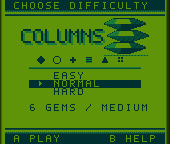
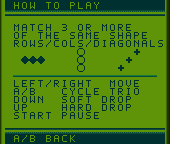
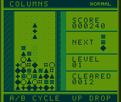

# Columns

Columns is a single-player falling-gem puzzle game for the original monochrome Game Boy. Open `columns.gb` in a Game Boy emulator and select a difficulty. The six gem types use a diamond, ring, cross, striped square, triangle, and four-dot pattern.

## Screenshots

| Difficulty menu | Help | Gameplay |
| --- | --- | --- |
|  |  | 

## How to play

Move the falling trio to line up three or more identical shapes horizontally, vertically, or diagonally. Gems above a match fall into the gaps and can trigger a cascade. Cascades earn more points, and the game speeds up every 18 gems you clear. A dotted outline shows where the current trio will land.

| Game Boy button | Action |
| --- | --- |
| Left / Right | Move the trio |
| A / B | Cycle the gems in opposite directions |
| Down | Soft drop |
| Up | Hard drop |
| Start | Pause or resume |
| Select while paused | Return to the difficulty menu |

Use Up or Down in the menu to select **Easy** for five gem types and slower gravity, **Normal** for all six types and medium gravity, or **Hard** for all six types and faster gravity. Press A or Start to play, or B for the in-game controls. At game over, press A to retry or B to return to the menu.

## Build the ROM

The source uses GBDK-2020 and Python 3. Set `GBDK` to the directory containing `bin/lcc` and run Make. The default path in the Makefile points to the ModRetro toolchain installed for this workspace.

```sh
make GBDK=/path/to/gbdk
```

The build writes `columns.gb` to the project directory.
